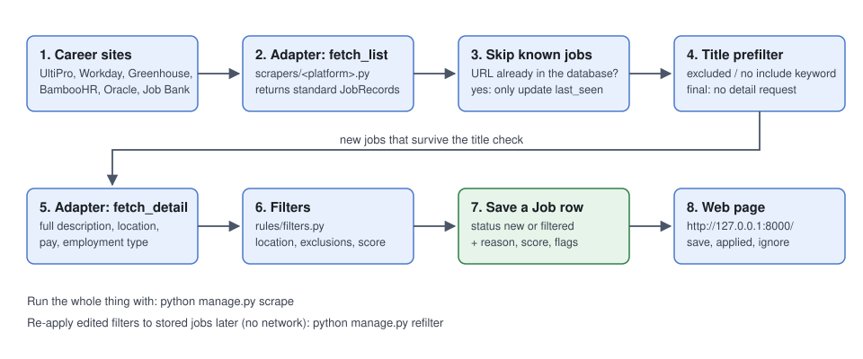
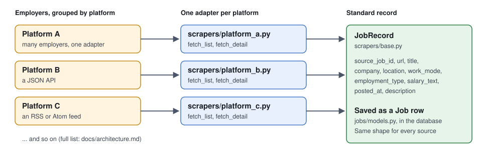

# Architecture

roleRecon checks the career pages of employers you choose, keeps the jobs that match your
rules, and shows them in a local web page. This page explains how that works, step by step,
and where each step lives in the code.

## The pipeline

Everything starts with `python manage.py scrape`
([`jobs/management/commands/scrape.py`](../jobs/management/commands/scrape.py)). For each
**active** employer in the database it does the following.

1. **Fetch the list.** The employer's *adapter* (see below) asks the career site for its
   current job list and returns a list of standard `JobRecord`s.
2. **Skip known jobs.** A job whose `url` is already in the database is not processed again.
   It only gets its `last_seen` time refreshed. This is how repeat runs stay fast and why
   running `scrape` twice in a row reports "0 new".
3. **Title prefilter.** For each new job the filters run once using only the list data. If the
   job is rejected because of its employer or title (excluded employer, excluded title keyword,
   or no include keyword), that rejection is final, so the slow detail request is skipped.
   Big employers can have hundreds of irrelevant jobs; this is what keeps a scrape quick.
4. **Fetch the detail.** For the rest, the adapter fetches the full posting: description,
   location, employment type, pay, posted date. One request per job, with a one-second pause
   between requests.
5. **Apply employer settings.** If the employer has `options` such as
   `{"location_override": "Toronto"}`, they are applied here. (Some Oracle sites list every job
   as just "Canada", so their jobs get "Toronto (actual location)" and can be matched against
   your accepted places.)
6. **Filter.** `evaluate()` in [`rules/filters.py`](../rules/filters.py) runs all checks and
   returns keep or reject, a reason, a score, and flags. See [config.md](config.md).
7. **Save.** A `Job` row is created with status `new` (kept) or `filtered` (rejected, with the
   reason stored). Rejected jobs are stored on purpose, so they are not fetched again next
   time and so you can see why they were rejected.
8. **Browse.** `python manage.py runserver` serves the two-pane page at
   `http://127.0.0.1:8000/`. Login is required; unauthenticated visitors are redirected to the
   Django admin login and returned to the job page after signing in. The page and its status
   updates require an authenticated Django account (code in [`jobs/views.py`](../jobs/views.py)
   and [`jobs/templates/jobs/job_list.html`](../jobs/templates/jobs/job_list.html)).

If a job has no description stored (because it was rejected on its title, or the source has
none), it gets the flag `no description`.

### Reading the summary line

Each employer gets one line, for example
`Acme: 106 found, 106 new (0 kept, 106 filtered: 98 title has no include keyword, 8 location not accepted)`.
The counts after "filtered" say which check rejected the jobs, which tells you at a glance
whether a keyword or location list is too narrow. Sources return at most a fixed number of jobs
(`MAX_JOBS` in the adapter, or the feed's `rows` setting); when a list reaches that number the
line is followed by a WARNING that jobs may have been cut off.

### Changing your rules later: `refilter`

Filtered jobs are not re-fetched, so editing `search_config.json` does not change them by
itself. Run `python manage.py refilter` to re-apply the current rules to every stored job that
is still `new` or `filtered`. It uses the stored text and makes no network requests. Jobs you
marked `saved`, `applied` or `ignored` are never touched.

One limitation: a job rejected on its title never had its description fetched. If an edit
later lets it through, its description-based checks (French, Java and so on) have not run.

## Adapters

A **platform** is the software an employer uses to publish jobs (Workday, UltiPro, Greenhouse
and so on). Many employers share a platform. An **adapter** is one Python module in
[`scrapers/`](../scrapers/) that knows how to talk to one platform. So adding a new employer
on a platform we already support is just a row in the admin, with no code.

Every adapter module provides the same two functions:

| Function | What it does |
|---|---|
| `fetch_list(board_url, session)` | Get the employer's jobs and return a list of `JobRecord`s (title, URL, location and whatever else the list provides). |
| `fetch_detail(board_url, rec, session)` | Get one job's full posting and return a dict of extra fields (`description`, `location`, `employment_type`, `salary_text`, `posted_at`, ...). Returns `{}` when the list already had everything. |

Adapters also contain small **parse functions** (for example `parse_search_results`,
`parse_detail`) that turn a saved response into records without touching the network. Those are
what the tests exercise, using small invented sample responses (see [testing.md](testing.md)).

This is the one list of supported platforms; other pages link here instead of repeating it. To
add an employer, find its platform's row and paste a URL shaped like the third column.

| Adapter | Platform | Board URL looks like | How it gets the data |
|---|---|---|---|
| `ultipro.py` | UltiPro / UKG | `recruiting.ultipro.ca/<tenant>/JobBoard/<id>` | POST to `/JobBoardView/LoadSearchResults` for the list; the detail page embeds the posting as JSON. |
| `workday.py` | Workday | `<tenant>.wd3.myworkdayjobs.com/<site>` | Public JSON API under `/wday/cxs/<tenant>/<site>`: `/jobs` for the list and the job's path for the detail. |
| `greenhouse.py` | Greenhouse | `job-boards.greenhouse.io/<board>` | One call to the public Job Board API, descriptions included. |
| `bamboohr.py` | BambooHR | `<name>.bamboohr.com/careers` | `/careers/list` and `/careers/<id>/detail`. |
| `oracle_hcm.py` | Oracle Recruiting Cloud | `<host>.oraclecloud.com/hcmUI/CandidateExperience/.../sites/<site>/...` | `hcmRestApi` list and detail endpoints. |
| `jobbank.py` | Job Bank (Canada) | the full Atom feed URL | Atom feed with title, employer, location and salary; no descriptions. Many employers in one feed, so each job carries its own `company`. |
| `erecruit.py` | Virtuo HR eRecruit (MediSolution) | `<host>/erecruit/...` (any page under it, or the `RSS.aspx` feed) | The site's `RSS.aspx` feed. It is malformed (the real postings sit in an HTML block after the closed `<rss>`), so it is read with a pattern, not an XML parser. It includes full descriptions, so no detail request is needed. |
| `successfactors.py` | SAP SuccessFactors | `<host>/<site>/go/Category-Page-<name>/<id>/` | The category's public RSS feed at `/services/rss/category/?catid=<id>`. It includes full descriptions, so no detail request is needed. |
| `phenom.py` | Phenom CareerConnect | `<host>/<country>/<language>/search-results` | The `/widgets` JSON endpoint returns paginated job records with description teasers; each job page exposes the full description as `JobPosting` JSON-LD. Known limitation: the search request currently has a Canada/Ontario location filter written into the code. |
| `workable.py` | Workable | `apply.workable.com/<account>` | Public `/jobs.md` list and per-job `/jobs/view/<id>.md` detail pages. |

How these endpoints were found: open the career site with the browser's developer tools on the
Network tab and watch which request returns the job data. Prefer a JSON endpoint; then static
HTML; use a real browser (Playwright) only as a last resort. No current adapter needs a browser.

## The standard job record

Every adapter fills in the same form, so everything after step 2 ignores where a job came from.
In code it is `JobRecord` ([`scrapers/base.py`](../scrapers/base.py)); in the database it is the
`Job` table ([schema.md](schema.md)).

## Job statuses

| Status | Meaning |
|---|---|
| `new` | Passed the filters and has not been triaged yet. |
| `saved` | You want to come back to it. |
| `applied` | You applied. |
| `ignored` | Not interested. |
| `filtered` | Rejected by the rules; `filter_reason` says why. |

You change status with the buttons on the web page, or in bulk in the admin.

## What is deliberately not built yet

- **Applying.** The tool finds and ranks jobs; you apply on the employer's site. Auto-apply is
  planned as a separate stage that only reads jobs you approved.
- **A LinkedIn source.** It comes last because of account risks.
- **AI scoring.** Scoring today is keyword counting only.
- **Closed-job detection.** A job that disappears from a board is not marked closed; its
  `last_seen` simply stops updating.
- **Network deployment.** The job page requires login and the development server defaults to
  `127.0.0.1`; before deploying beyond this machine, configure HTTPS, trusted hosts and secure
  cookies using Django's deployment checklist.
