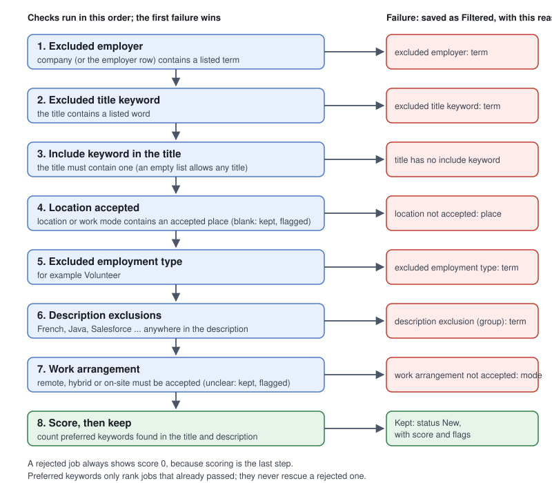

# Configuration: `search_config.json`

All of your preferences live in one JSON file in the project root, `search_config.json`. It is
**not committed** (it is in `.gitignore`) because it reflects your personal search. The committed
template is `search_config.example.json`; copy it to start:

```
cp search_config.example.json search_config.json
```

Rules for the file:

- Any key that starts with `_` is a comment and is ignored (`_comment`, `_accept_comment`, ...).
- `search_config.example.json` is the sanitized template for the supported configuration shape.
  When adding, removing or changing config keys, update the example in the same change; never
  copy personal search values into it.
- Duplicate entries in a list are removed when the file is loaded (ignoring capitals), so
  `"Intern"` and `"intern"` count once. The file itself is not rewritten.
- After editing it, run `python manage.py refilter` so jobs already in the database are
  judged by the new rules.

## The keys

```json
{
  "titleMatch":  { "includeKeywords": [...], "wholeWords": true },
  "locations":   { "accept": [...] },
  "filters": {
    "excludedEmployers": [...],
    "excludedTitleKeywords": [...],
    "excludedEmploymentTypes": [...],
    "descriptionExclusions": { "languageRequirements": [...], "technicalRequirements": [...],
                               "platformExclusions": [...], "compensationTypes": [...] },
    "preferredKeywords": [...]
  },
  "workArrangement": { "acceptRemote": true, "acceptHybrid": true, "acceptOnsite": true }
}
```

| Key | What it does |
|---|---|
| `titleMatch.includeKeywords` | **A job's title must contain at least one of these**, otherwise it is rejected. An empty list allows any title. Employer career pages return *every* job they have, so this is what narrows them to the roles you want. |
| `titleMatch.wholeWords` | `true` (default): match whole words only, so `java` does not match `javascript` and `intern` does not match `internal`. `false`: plain substring matching. |
| `locations.accept` | Place names. A job passes if its location (or work mode) contains one. Add `Remote` to accept remote jobs. An empty list accepts every location. A job with **no** location is kept and flagged `location unclear`. Matching is by whole word, so list every town you want. |
| `filters.excludedEmployers` | Reject if the company contains one of these (plain substring). Only useful for sources that list many employers, such as Job Bank. |
| `filters.excludedTitleKeywords` | Reject if the title contains one of these words. |
| `filters.excludedEmploymentTypes` | Reject if the employment type contains one of these (e.g. `Volunteer`). |
| `filters.descriptionExclusions` | Reject if the **description** contains any of these. The group names (`languageRequirements`, `technicalRequirements`, ...) only organise the list and show up in the rejection reason. To exclude part of a product, list the specific phrase, e.g. `Guidewire ClaimCenter` instead of `Guidewire`. |
| `filters.preferredKeywords` | **Not a filter.** Each one found in the title or description adds 1 to the job's score. |
| `workArrangement` | Whether remote, hybrid and on-site jobs are acceptable. A job whose arrangement cannot be determined is kept and flagged `arrangement unclear`. |

## Scoring, and why a "high score" job can still be rejected

`filters.preferredKeywords` are **not** search terms and they do **not** let a job through.
They only affect a job's score, which is used to sort the list (best first).

The title check uses `titleMatch.includeKeywords`. A job that is full of your preferred words
but whose title has none of your include keywords is rejected. For example, if you were searching
for burger-flipping jobs, "Hamburger" belongs in `includeKeywords`; putting it in
`preferredKeywords` would only make jobs that mention it sort higher *once they have already
passed*.

The filters run in a fixed order and the first failing check wins (see the diagram below). The
score is calculated last, only for jobs
that passed every check, so **a rejected job always shows a score of 0**. If a job you expected
is rejected, look at its `filter_reason` (the "Filtered out" tab on the web page) to see which
check stopped it.



## Matching details

- Matching is case-insensitive.
- `excludedEmployers` and `excludedEmploymentTypes` use plain substring matching. Titles,
  locations and descriptions use whole-word matching unless `wholeWords` is `false`.
- A "word" boundary treats anything that is not a letter, digit or underscore as a separator,
  so terms with symbols (`C++`, `.NET`) still match.

## Per-employer settings (not in this file)

Settings that belong to one employer are stored on the Employer row (field **Options**, JSON),
not in `search_config.json`. Currently supported: `{"location_override": "Toronto"}`, which
replaces a useless location such as "Canada" with a place you can match in `locations.accept`.

## The other config file

`linkedin_config.json` (also gitignored) is left over from an earlier LinkedIn Easy Apply
project. It still holds personal details, resume choices and screening answers. It is not read
by the current tools; it is kept for the future "apply" stage.
