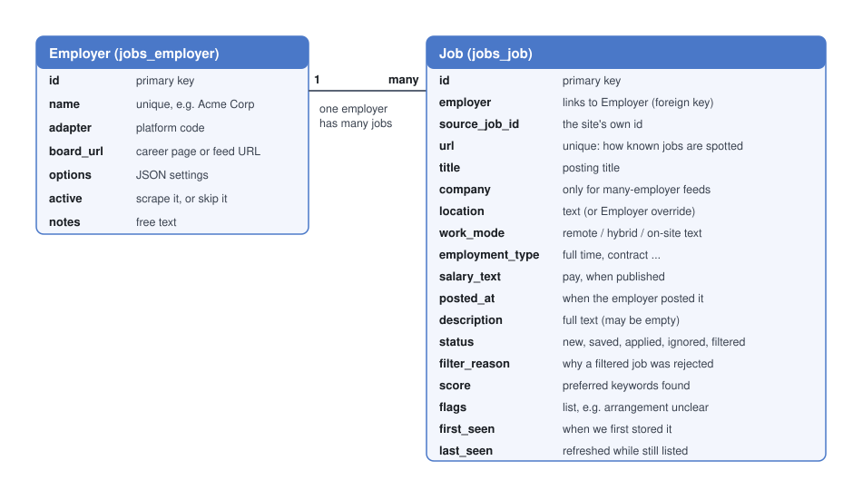

# Database schema, migrations and Supabase

The database is Postgres, hosted on Supabase. Django talks to it directly (not through
Supabase's own web API). The tables are defined in Python in
[`jobs/models.py`](../jobs/models.py); Django creates and changes them for you through
*migrations*.

## Employer

One row per career site (or feed) that is checked.

| Field | Meaning |
|---|---|
| `name` | Unique display name, e.g. `Acme Corp`. |
| `adapter` | Which adapter handles it, chosen from a list defined in `jobs/models.py` (one entry per module in `scrapers/`; see the table in [architecture.md](architecture.md)). A few entries (`lever`, `html`, `browser`, `linkedin`) are reserved and have no adapter yet. |
| `board_url` | The career page or feed URL. Each adapter documents what it expects; extra parts such as `?query` strings and `/details/...` are ignored where noted. |
| `options` | JSON settings for this employer. Today: `{"location_override": "Toronto"}`. Use `{}` when there are none. |
| `active` | Untick to skip an employer without deleting it or its jobs. |
| `notes` | Free text. |

## Job

One row per posting, in the standard shape every adapter produces.

| Field | Meaning |
|---|---|
| `employer` | Which Employer it came from (a foreign key). |
| `source_job_id` | The site's own id for the job. |
| `url` | **Unique.** A job whose URL is already stored counts as known. |
| `title`, `location`, `work_mode`, `employment_type`, `salary_text`, `posted_at`, `description` | The posting's details, as far as the source provides them. Any can be empty. |
| `company` | Only set by sources that list many employers (Job Bank); the filters and the page then use it instead of the Employer name. |
| `status` | `new`, `saved`, `applied`, `ignored` or `filtered`. |
| `filter_reason` | Why a `filtered` job was rejected, e.g. `location not accepted: Winnipeg`. |
| `score` | How many of your preferred keywords were found. Always 0 for rejected jobs. |
| `flags` | A list of warnings such as `arrangement unclear`, `location unclear`, `no description`. |
| `first_seen`, `last_seen` | When the job was first stored, and when a scrape last saw it still listed. |

## Migrations, in plain words

A **model** is a Python class that describes a table. A **migration** is a small numbered
Python file that describes *one change* to the database (create a table, add a column, change
a list of choices). Migrations are how the database and the code stay in step, and they are
kept in git so anyone can rebuild the same database.

There are two commands, and they do different things:

| Command | What it does |
|---|---|
| `python manage.py makemigrations jobs` | Compares `models.py` with the existing migrations and **writes a new migration file** for any difference (for example `0004_job_company_alter_employer_adapter.py`). It does not touch the database. |
| `python manage.py migrate` | **Applies** every migration that the database has not seen yet, in order, and records which have been applied. This is the step that actually changes the tables. |

Typical flow after editing `models.py`: run `makemigrations`, read the summary it prints
("Add field company to job"), then run `migrate`. Running `migrate` on a brand-new database
builds everything from scratch, including Django's own tables for the admin login.

The migration files live in [`jobs/migrations/`](../jobs/migrations/), numbered in order. Each
file's name and its `operations` list say what it changes, so this page does not repeat them.
Changing the list of `choices` on a field (for example, adding an adapter) produces a migration
even though the table itself does not change; that is normal.

## Supabase notes

- **Connection string.** Use Supabase's **session pooler** connection string as `DATABASE_URL`
  in `.env`. The "direct" connection is IPv6-only and fails on networks without IPv6.
- **Data API off.** Supabase can expose tables through an automatic web API. This project does
  not use it (Django connects straight to Postgres), so it is turned off. That also means the
  tables are not reachable through Supabase's API even without row-level security.
- **Write data through Django** (the admin, the web page, or the commands), not through
  Supabase's Table Editor. Django fills in defaults (empty text, `{}`, timestamps) in Python,
  not in the database, so rows typed into the Table Editor can fail with "null value" errors.
  Looking at data in the Table Editor is fine.
- **Secrets.** `.env` holds the connection string and is never committed. `.env.example` lists
  the same required variable names with empty or safe placeholder values. When required
  environment variables change, update `.env.example` in the same change; never copy real
  secrets into it. When the `search_config.json` schema changes, update
  `search_config.example.json` in the same change with the same keys and nesting but sanitized
  values.
